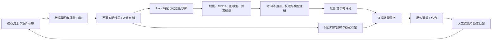

# 基于资金图谱的企业级反诈方案

## 1. 结论

当前数据可以支撑数据契约、回溯分析、可疑链路验证和服务接口联调，但不能支撑生产模型审批。
关键原因不是算法不足，而是标签缺少 `risk_event_at` 和 `label_available_at`，且 59 个嫌疑账户中
只有 3 个出现在交易图中。任何基于当前静态标签给出的高 AUC 都必须视为诊断结果，不能用于止付、
冻结或客户处置。

本项目因此采用两条并行主线：

1. 当前可运行纵向切片：验证数据治理、严格 `as_of`、版本追踪、证据链、API 和部署边界。
2. 生产目标平台：补齐时序标签和案件闭环后，再实施滚动回测、候选模型、校准、影子运行和审批。

## 2. 当前数据审计

| 项目 | 结果 | 生产含义 |
|---|---:|---|
| 账户数 | 11,087 | 可用于接口和批处理联调 |
| 交易数 | 904,395 | 覆盖 2025-07-01 至 2025-12-31 本地时间 |
| 有交易账户 | 7,795 | 3,292 个账户无观察期交易 |
| 嫌疑账户 | 59 | 仅 3 个有交易，共涉及 16 笔交易 |
| 受害账户 | 1,153 | 仅 31 个有交易 |
| 无边风险账户 | 1,178 / 1,212 | 风险标签和资金图严重错位 |
| 风险账户间直接边 | 0 | 无法据此评估团伙关联命中率 |
| 自转账 | 440 | 需要明确是否为内部划转、冲正或有效交易 |
| 负金额 | 2 | 需要补充冲正/退款语义，不应简单取绝对值上线 |
| 标签可用时间 | 缺失 | 无法证明未来标签泄露为 0 |
| 交易 ID | 源文件缺失 | 接入层生成稳定行级 ID，仅供本数据版本追踪 |

另一个高风险信号是账户画像捷径：1,212 个风险相关账户中有 1,203 个为对私账户。画像模型
明显优于行为模型，并不代表资金风险识别能力更强，而是模型可能学习了客户类型和数据缺失模式。

## 3. 目标架构



生产部署建议使用银行已有基础设施替换本地实现：对象存储与数据目录替换本地 Parquet，
Spark/Flink 替换单机特征任务，MLflow 或内部模型平台承担审批，ClickHouse/PostgreSQL/合规图存储
承担低延迟查询，Kafka 承担事件投递。当前 DuckDB + Parquet 实现用于验证合同和行为，不作为
大规模在线图查询方案。

## 4. 数据与时间定义

生产标签表至少需要：

```text
account_id
label
risk_event_at
label_available_at
case_id
label_source
label_status
```

以预测锚点 `t` 建立样本：观察窗口 `[t-L, t)`，预测窗口 `[t, t+H)`。历史上已经确认的风险账户
不进入“新增风险账户”目标，但可作为当时已知的风险种子。尚未走完 `H + 标签成熟期` 的未标记账户
属于删失样本，不能直接当负样本。

训练、验证、测试必须按锚点时间滚动前推。发生在锚点之后的交易、标签、案件状态、图结构统计、
embedding 和标准化参数都不得进入当前样本。每次特征构建需要通过“未来扰动不变性测试”：向原始
数据添加任意未来交易和未来标签后，同一 `as_of` 的特征哈希必须保持不变。

## 5. 模型路线

推荐按风险和收益逐层推进，而不是直接上复杂动态图神经网络。

1. 规则层：短期多入一出、一入多出、扇入扇出突增、快速过渡、回流、风险种子邻近。
2. 强表格基线：LightGBM/CatBoost 使用多窗口行为、图统计和时序特征，按运营容量选择阈值。
3. 图表示层：方向感知 GraphSAGE/GAT；入边和出边分开聚合，边编码包含时间、金额箱和渠道。
4. 动态层：只有精确事件顺序可信时采用 TGN/TGAT；粗时间桶优先采用图快照 + GRU。
5. 漏标层：Bagging-PU 或可靠负样本，辅以图异常分数；异常不等于涉诈，必须校准。
6. 集成层：用时间折 OOF 分数训练简单融合器，避免在训练内预测上学习二层模型。

不建议使用账户 ID embedding 作为主特征，它会降低新账户泛化能力并容易记忆历史名单。画像、行为、
图结构和风险种子特征必须分别消融，画像捷径不能掩盖行为模型失效。

## 6. 评估与审批

主指标应是 `PR-AUC`、`Recall@审核容量`、`Precision@K`、`Lift@Top5%` 和校准误差，ROC-AUC 只作为
辅助指标。结果需按活跃/无交易、客户类型、地区、渠道、新老账户和时间段分层，并用账户级 bootstrap
给出置信区间。

模型上线需要依次通过：数据门禁、时间外回测、稳定性与公平性审查、概率校准、业务容量评估、
模型风险审批、影子运行、灰度发布和回滚演练。阈值是受治理的业务配置，不应固化为 `0.5`。

当前回溯诊断结果如下，均为 `production_eligible=false`：

| 特征集 | ROC-AUC | PR-AUC | Top5% 召回 | 解读 |
|---|---:|---:|---:|---|
| 行为 | 0.8173 | 0.0155 | 15.25% | 交易风险识别能力不足 |
| 画像 | 0.9243 | 0.0696 | 57.63% | 高度疑似客户类型/缺失模式捷径 |
| 行为 + 画像 | 0.9341 | 0.0777 | 57.63% | 增益主要来自画像，不能据此上线 |

## 7. 证据与研判语义

证据必须从结构化事实生成，不允许语言模型补写不存在的交易或路径：

- A 级：存在至少两跳、时间单调、时间间隔和金额连续性合规的源交易链路。
- B 级：有交易行为或直连关系，但没有合格多跳链路。
- C 级：观察窗口无交易；风险分数本身不能作为案件证据。

每个关联账户和路径都携带交易 ID、路径 ID、方向、最短跳数和证据码。报告同时携带数据版本、特征
截止时间、模型版本、训练模式、上线资格和阻断原因。系统只给人工研判建议，不执行自动冻结。

## 8. 已实现纵向切片

| 能力 | 当前实现 |
|---|---|
| 数据接入 | XLSX 流式读取、PyArrow 契约、UTC 归一、SHA-256、月份分区 |
| 质量门禁 | 标签一致性、引用完整性、自转账、负金额、缺少标签时间 |
| 版本治理 | 数据、特征、模型、评分均有实现版本和内容派生版本 |
| 原子发布 | 数据、特征、模型、评分先写临时目录，完成后原子发布 |
| 特征 | 严格 `[as_of-lookback, as_of)` 的账户行为和独立画像特征 |
| 基线模型 | 加权逻辑回归、分层 OOF 诊断、画像捷径消融 |
| 时序样本与训练 | 观察/预测窗口、标签成熟期、滚动锚点切分；规则与逻辑回归统一评估 |
| 验收评估 | PR-AUC、ROC-AUC、Top-K 召回/精确率、Lift、Brier、分群指标；证据/关联评估缺真值即阻断 |
| 图解释 | 有向、时间有序、跳数/间隔/金额连续性约束的路径搜索 |
| 关联发现 | Top-K 关联账户，附最短跳数、方向、路径和交易证据 |
| 研判输出 | A/B/C 证据包和确定性 Markdown 报告 |
| 服务 | FastAPI 存活/就绪、风险、证据、关联账户和报告接口 |
| 工程 | Ruff、严格 MyPy、Pytest、CI、Dockerfile、结构化脱敏日志 |

### 运营工作台与复核闭环（新增）

当前服务提供两个可运行页面：风险账户工作台 `/` 和案例复核工作台 `/reviews`。页面采用冰白、
深海军蓝、蓝色行动色和低圆角边界，适配高频运营扫描；不是营销落地页。复核页读取不可变案例包，
展示证据哈希、结构化事实、路径、限制和报告，并提供主审/仲裁模板下载。

复核写入默认关闭。只有在银行 IAM/API 网关已完成身份认证并注入
`X-Verified-Reviewer-Id`、`X-Verified-Reviewer-Role` 后，才允许使用
`--enable-review-writes --trust-review-identity-headers`。身份、时间和人工结论不能由浏览器请求体
生成；服务按案例哈希、阶段和重复提交规则校验，保留追加式提交记录。当前案例包已通过离线双人独立复核，
正式结果保存在 `task3_manual_acceptance.json`；页面可用性本身不参与任务 3 验收判定。

## 9. AI 辅助编码实施顺序

后续开发应拆成有验收标准的小任务，每个任务都要求测试和数据边界说明：

1. 扩展标签契约并实现锚点样本表；验收是未来扰动不变性和边界时刻测试。
2. 实现滚动时间折与标签成熟期；验收是训练/验证/测试锚点无交叉。
3. 增加多窗口行为、风险种子和图结构特征；验收是所有特征声明 `as_of` 来源。
4. 实现规则和 LightGBM 基线；验收是时间外指标、校准和分群报告。
5. 实现方向感知 GraphSAGE；验收是相对强基线的稳定增益和无 ID 记忆消融。
6. 增加案件反馈、模型注册和阈值审批；验收是可回滚、可审计、双人复核。
7. 将路径仓库替换为有索引的批准存储；验收是 P95 延迟、超时、限流和查询预算。
8. 最后接入受约束的 LLM 摘要；输入只能是证据 JSON，输出需经过引用一致性校验。

每次让 AI 编码时，应把数据契约、允许修改的模块、不可违反的时点规则、验收测试和禁止行为一起写进
任务描述。不要只给“实现一个反诈 GNN”这类无法审计的宽泛指令。

## 10. 上线前硬性缺口

- 提供 `risk_event_at`、`label_available_at`、标签来源和标签状态变更历史。
- 提供真实稳定的交易 ID，以及冲正、退款、撤销和内部划转语义。
- 补充渠道、交易类型、账户状态；设备/IP 等增强数据可后续接入。
- 明确数据抽样、图边界、跨行交易缺失和无交易风险账户形成原因。
- 提供案件或团伙真值，才能客观评估关联账户命中率和路径解释通过率。
- 接入银行 IAM、API 网关、密钥管理、审计平台、模型注册和人工处置闭环。

## 11. 当前数据的验收结论

重新接入当前源文件后，数据版本为 `d02568e53fa4e3e3`，接入层已支持可选渠道、交易类型、借贷方向和跨区字段。
当前仍有以下硬阻断：标签表没有 `risk_event_at`、`label_available_at`、`case_id`，因此时序样本命令会拒绝运行，
关联账户真实命中率不能计算。任务 1、任务 2 统一定位为静态回溯实验；行为逻辑回归 ROC-AUC 约 `0.8162`、PR-AUC
约 `0.0154`、Top5% 召回约 `15.25%`；画像/组合模型的高分来自客户类型和无交易模式，均标记为
`production_eligible=false`。这不是代码失败，而是为了避免在缺少标签时间和关系真值时把不可审计结果用于止付冻结。

补齐时间标签后，执行 `build-temporal-samples` 和 `train-temporal` 会生成按锚点隔离的 train/validation/test
产物，并在 manifest 中记录未来交易和未来标签泄露率；补齐案件关系真值后，系统才能给出关联账户真实命中率。

当前已导出 5 个绑定证据哈希的待复核案例，包含 1 个两跳链路案例和 4 个直接关系加结构模式案例。任务 4 已通过
结构化证据和最终 Markdown 文件的双重验收：5/5 报告一致，证据类型覆盖率、完整率和精确渲染匹配率均为
100%。正式产物见 `var/artifacts/case_samples/a04894ae2c18991c/task4_acceptance.json`。

任务 3 的人工案例替代指标不依赖案件关系真值，但必须由真实复核人员完成：每个案例至少两名独立人工复核员，
五个案例至少十份主审记录，严格案例通过率不低于 70%；冲突案例必须由第三名复核员仲裁。自动预检在数据结构上
标记为 `automated_precheck`，不会计入人工通过率。填写方法和判定口径见 `docs/task-3-4-acceptance.zh-CN.md`。
